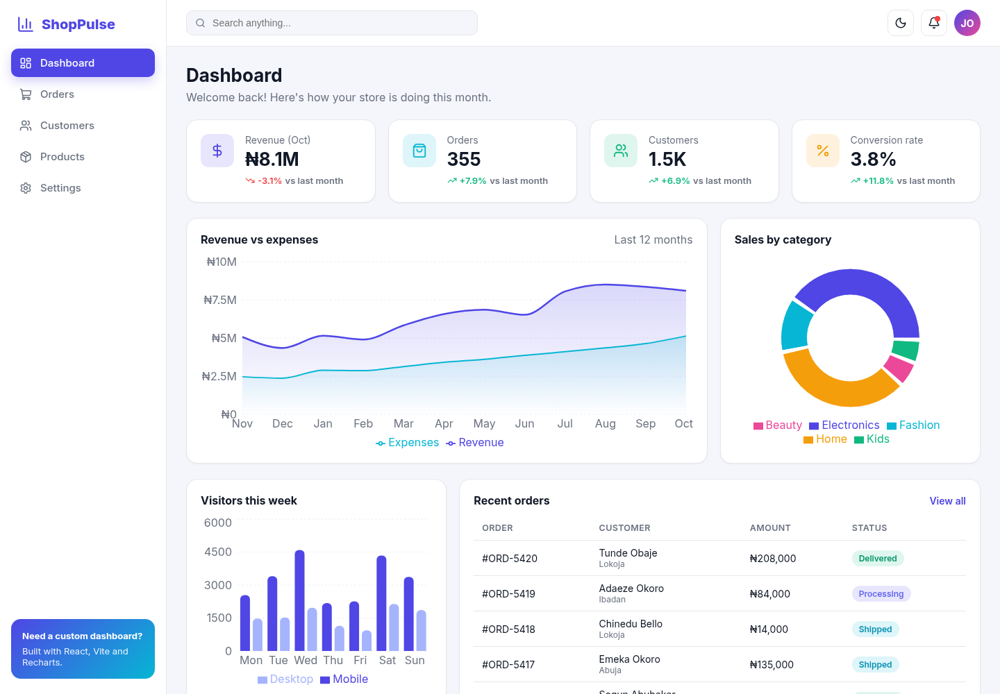
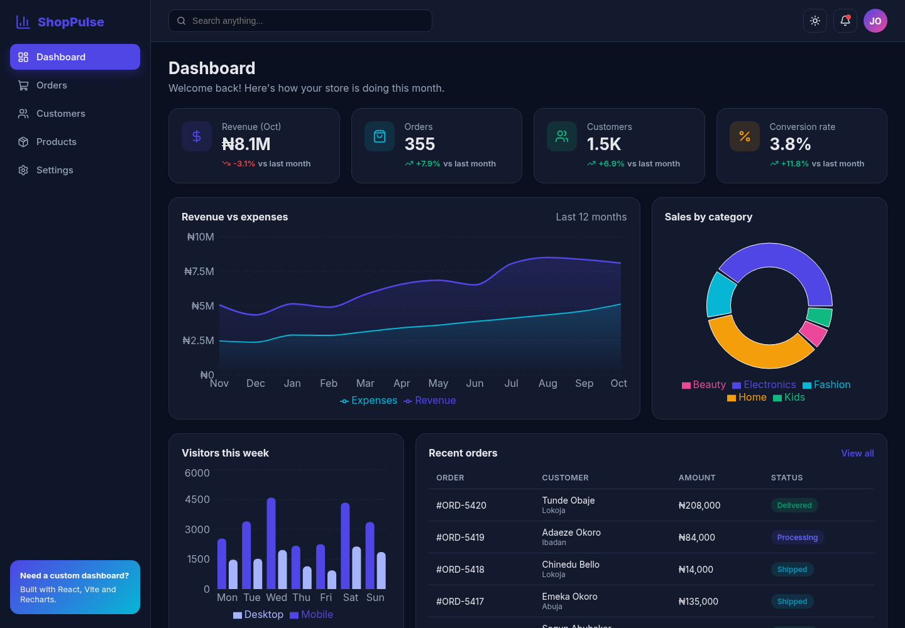
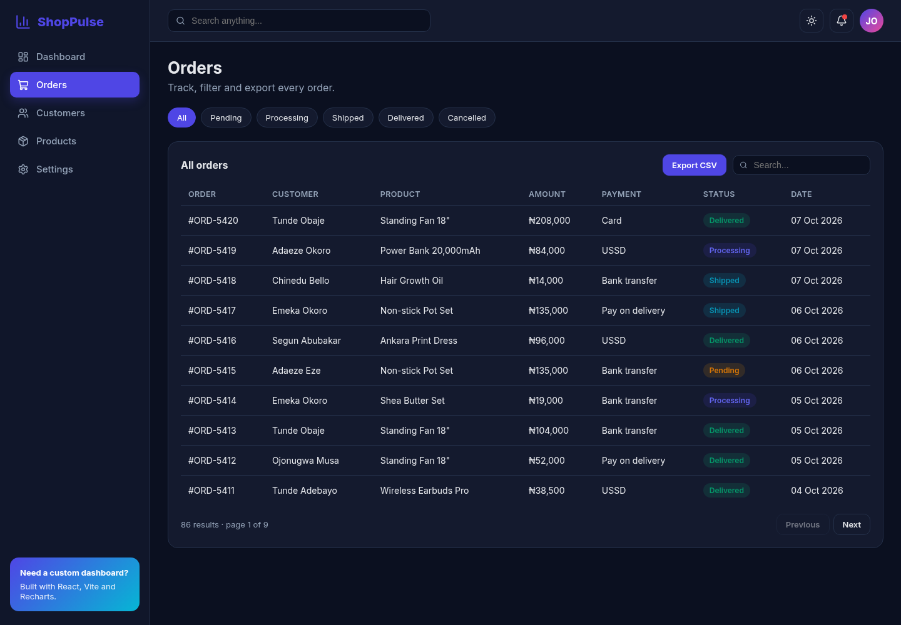

# React Admin Dashboard


-brightgreen)


**ShopPulse** is a modern, responsive admin dashboard for an e-commerce store, built with **React 19, Vite and Recharts**. It has KPI cards, interactive charts, data tables you can search, sort, paginate and export to CSV, and a **dark mode** that remembers your choice. All amounts are in Naira (₦), using realistic mock data.

| Light | Dark |
| --- | --- |
|  |  |



## Features

- **Dashboard**:
  - KPI cards with month-over-month trends
  - revenue vs expenses area chart, sales-by-category donut, weekly visitors bar chart
  - recent orders and low-stock alerts
- **Orders**: status filter chips, search, sortable columns, pagination and **CSV export**
- **Customers** and **Products** pages built on the same reusable `<DataTable>`, with low-stock badges
- **Settings** form
- **Dark and light mode**:
  - built on CSS variables
  - follows the system preference on first visit, then saves your choice in `localStorage`
- **Responsive**: the sidebar becomes a slide-in drawer on mobile
- **Accessible**: icon buttons have labels, and the tabs and form controls are semantic
- **Deterministic mock data** from a seeded random generator, so screenshots and tests are stable
- **HashRouter**, so it deploys to GitHub Pages or any static host without server configuration
- **9 Vitest and React Testing Library tests** covering the table helpers, formatters, navigation, filtering, sorting and the dark mode toggle

## Tech stack

React 19, Vite 8, React Router 7, Recharts 3, lucide-react icons, plain CSS (custom properties), Vitest, React Testing Library, jsdom

## Getting started

Requires Node.js 20.19 or newer.

```bash
git clone https://github.com/Josephobaje/react-admin-dashboard.git
cd react-admin-dashboard
npm install
npm run dev        # http://localhost:5173
```

```bash
npm test           # run the test suite
npm run build      # production build in dist/
npm run preview    # serve the production build
```

### Connect a real API

All data comes from `src/data/mockData.js`. To use a real backend, for example my [Node Express Auth API](https://github.com/Josephobaje/node-express-auth-api) or [Inventory & Orders API](https://github.com/Josephobaje/inventory-orders-api-php), replace those exports with `fetch` calls, or with React Query, and pass the results to the same components.

## Project structure

```text
src/
  components/   # Layout (sidebar + topbar), StatCard, DataTable, StatusBadge
  pages/        # Dashboard, Orders, Customers, Products, Settings
  hooks/        # useTheme (dark mode + persistence)
  data/         # seeded mock data
  utils/        # formatters (₦, compact numbers) and table helpers + tests
  styles.css    # theme variables, layout, responsive rules
```

## Author

**Joseph Obaje**, Full Stack Developer (PHP, Python, Flutter) and Cybersecurity Specialist

- GitHub: [@Josephobaje](https://github.com/Josephobaje)
- LinkedIn: [joseph-obaje](https://www.linkedin.com/in/joseph-obaje)
- Email: [josephobaje264@gmail.com](mailto:josephobaje264@gmail.com)

## License

Released under the [MIT License](LICENSE). © 2026 Joseph Obaje
